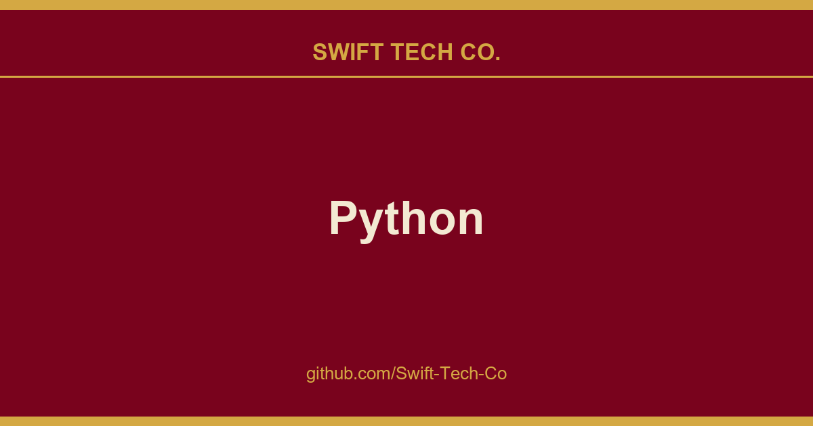

# Python

## What This Is

A practical reference entry for product and engineering: the Python notes, examples and fixes we reach for repeatedly. Kept current as part of the wider Swift Tech Co. engineering library.

## Images

## 🚀 Getting Started

📋 Read through our [Contribution Guidelines](CONTRIBUTING.md) before you contribute.

## 🌐 Community Channels

We are on Telegram! Community channels are a great way for you to ask questions and get help. Please join us!

## 📜 List of Algorithms

See our [directory](DIRECTORY.md) for easier navigation and a better overview of the project.

---

## Swift Tech Co.

Built and maintained by Swift Tech Co.

AI Automation | FinTech Platforms | Custom Software and Mobile Apps | SaaS Platforms | Cloud Infrastructure | Cybersecurity | SEO and Marketing | API Integration

**Join our community on Telegram:** [t.me/+Qt_eFvkb2rliMzNh](https://t.me/+Qt_eFvkb2rliMzNh)

Home | Services | Careers | Referral Program | Influencers | About | Contact

**Connect**

- Website: https://github.com/Swift-Tech-Co/Python
- LinkedIn: [linkedin.com/in/stephenoladoke](https://www.linkedin.com/in/stephenoladoke/)
- LinkedIn (Company): [linkedin.com/company/swift-tech-co](https://www.linkedin.com/company/swift-tech-co)
- X: [@MrOladoke](https://x.com/MrOladoke)
- Instagram: [@mr.oladoke](https://www.instagram.com/mr.oladoke/)
- Instagram (Company): [@swifttechco](https://www.instagram.com/swifttechco/)
- Organization: [github.com/Swift-Tech-Co](https://github.com/Swift-Tech-Co)

## Sources

Compiled and maintained from upstream [TheAlgorithms/Python](https://github.com/TheAlgorithms/Python) under permissive open-source license.

---

Maintained by [Swift Tech Co.](https://github.com/Swift-Tech-Co) - [Telegram](https://t.me/+Qt_eFvkb2rliMzNh)

## Sources

Compiled and maintained from upstream [TheAlgorithms/Python](https://github.com/TheAlgorithms/Python) under permissive open-source license.

---

Maintained by [Swift Tech Co.](https://github.com/Swift-Tech-Co) - [Telegram](https://t.me/+Qt_eFvkb2rliMzNh)

## Sources

Compiled and maintained from upstream [TheAlgorithms/Python](https://github.com/TheAlgorithms/Python) under permissive open-source license.

---

Maintained by [Swift Tech Co.](https://github.com/Swift-Tech-Co) - [Telegram](https://t.me/+Qt_eFvkb2rliMzNh)